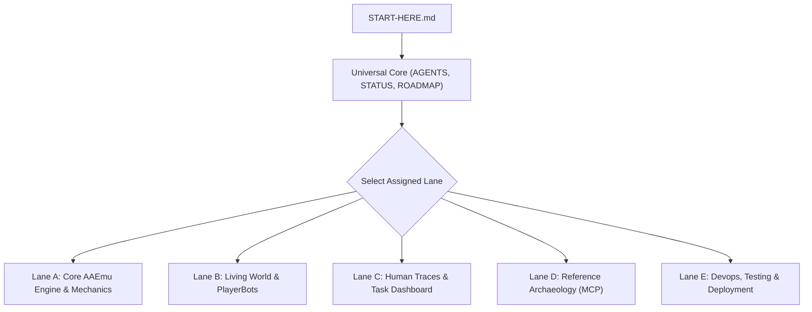

# START HERE — Agent Onboarding & Domain Lane Dispatcher

Last reviewed: 2026-10-11 · documentation/source-comparison baseline `develop` / `aa057ffc3bb4596f4a6972eb4f012994970e163a` plus inherited projection and documentation/UI changes. This is not a fresh gameplay gate.

**User-approved fork direction:** reuse existing PlayerBot capabilities and shared
server services to deliver useful supported goal-to-goal autonomy, then expand into
livelihood/commerce, cooperation and social presence. Necessary core repairs are
greenlit; exhaustive human parity, a new brain and a port per external module are
not prerequisites. Start with the [bootstrap below](#new-session-bootstrap),
[canonical task state](.omp/state/CURRENT.md#session-resume) and
[current policy checkpoint](STATUS.md#current-playerbot-policy-checkpoint).
The [approved roadmap](ROADMAP.md#playerbot-extension-roadmap) supersedes older
next-work recommendations, not dated evidence, invariants or milestone exits.
Main owns integration; Vibe is off, native OMP delegates have bounded ownership,
and there is no Muse handoff. Roadmap approval is not implementation acceptance,
an automatic branch merge or a live-campaign instruction.

This document is the **single authoritative router** for agents and developers entering this repository. It tells you what to read, what to ignore, which domain lane to enter, and where active backlogs and verification gates live.

---

## New-session bootstrap

1. Read [CURRENT](.omp/state/CURRENT.md#session-resume), its linked
   [decisions](.omp/state/DECISIONS.md) and [evidence](.omp/state/EVIDENCE.md),
   then AGENTS, this router, PROJECT-CONTROL, STATUS, SCORECARD and ROADMAP.
   Establish the active objective, permitted mode, pending decisions and actual
   next action before dispatching work.
2. Record the actual checkout SHA, branch, relevant dirty paths, worktrees and
   active file/process ownership. The inspected baseline above is a reference,
   not a substitute for your session's baseline. Preserve user work; E130's
   recovery branch is separate and unmerged until the user decides otherwise.
   Open the dashboard's [Delivery & Sessions workflow](Scripts/playertrace-coverage/README.md#delivery--sessions-workflow),
   select the active bounded card and relevant feature bibliography, then use its
   saved checkpoint/brief. These are operational records, not automatic OMP launches
   or canonical proof. Continue coherent work; checkpoint before a reasoned fresh
   session. Do not silently change criteria or restart a broad audit.
3. Read the [developed capability baseline](ROADMAP.md#current-developed-capability-baseline)
   and [integration direction](PROJECT-CONTROL.md#playerbot-integration-direction).
   Distinguish engine service, bot action, wired policy, recorded live proof and
   missing evidence. Seed purchase, housing, transactions and party actions already
   have implementations; do not recreate them because a broader loop is unproved.
4. Use the [current ownership contract](PROJECT-CONTROL.md#current-playerbot-ownership-contract):
   production activity arbitration/roam, quest-specific behavior ownership and
   separate homestead GOAP are existing paths, not a demonstrated universal GOAP
   runtime. Reconcile only the chosen slice and immediate dependencies, not another
   full architecture audit. Use archaeology and relevant corpus for disputed facts;
   external module source is a pattern reference, never ArcheAge gameplay authority.
5. The first approved engineering priority is [finite existing-owner A→eligible B
   handoff](ROADMAP.md#next-bounded-playerbot-priority), including the same giver.
   Before implementation, record one bounded card: reusable outcome, source/dirty
   baseline, owner/files, supported denominator, failure hypothesis, authoritative
   result, interruption OR failure recovery, follow-up choice, proof layer and stop.
   Preserve AdvanceEnter's guard/counter; reproduce first and repair only a shown
   failure. Do not dispatch a new planner or require every tutorial/quest.
6. Main integrates disjoint native OMP slices and owns final acceptance. Verify the
   changed behavior at its required layer, record actual results/limits, update
   canonical records and dashboard, then select the next dependency. Historical
   Muse/loop recipes, old farm/parity-first queues and audit recommendations are
   reference only; they grant no new source, merge, deployment or runtime authority.


## Universal workflow — every zone, feature and mechanic

Use the [discovery-to-delivery contract](.kanban-templates/implementation.md):
**scope → inventory archaeology/code/tests/corpus → reconcile gaps → order slices →
implement/verify → reconcile and expand**. Parent briefs define coverage and missing
dependencies; child cards prove bounded outcomes. For each next zone/variant, reuse
proved shared mechanics and verify the local differences. Farm is the current
application, not the limit of this process.

## Immediate dispatch priority — 2026-09-16 (SUPERSEDED as dispatch source by `STATUS.md`, 2026-10-01)

First product journey: [ordinary starter → owned small plot → harvest/replant](ROADMAP.md#first-owned-small-plot-journey).
Current priority/allocation limits are in [STATUS](STATUS.md#current-playerbot-policy-checkpoint);
the pointers below are retained livelihood requirements, not universal gates for quest autonomy.
Use the [shared implementation template](.kanban-templates/implementation.md) for
every implementation; fill it once in the existing card/dossier. The canonical route
requires prerequisite quests and level-10 eligibility, not a direct level-7 shortcut.

**Anti-drift rule:** a scenario/quest/lane/benchmark/bug/campaign validates a reusable capability; it never becomes the objective unless canonical docs promote it. Full rule: [PROJECT-CONTROL.md](PROJECT-CONTROL.md#delivery-contract). Name capability + failure mechanism + confirm/reject evidence before scenario-specific work; otherwise stop and reassess.
Read the [high-priority corrective queue](ROADMAP.md#high-priority-corrective-queue--2026-09-16)
before expanding homestead/GOAP work. Synthetic tests prove their simulated scope,
not real gameplay loops. The [mandatory reporting gate](AGENTS.md#evidence-honesty-and-anti-overclaim-gate-2026-09-16)
requires explicit fixture/bypass disclosure, evidence layer and what remains unproved.
Core reliability and independent human-playability work may continue.

**Correction note (2026-10-01).** Both dates in this section were re-verified against
the commits and are correct as written: the corrective queue is dated **2026-09-16**
and the Wave One closeout exit is dated **2026-09-18** (`ROADMAP.md:90` program header,
`ROADMAP.md:108` exit row, `ROADMAP.md:110` freeze note). The freeze is **lifted only
for the verified claim→construct loop**; further GOAP actions, combat behavior, route
content, homestead breadth (plant/harvest/tax), multi-bot scenarios, ordinary
acquisition, and `H` remain **frozen/open**. See the dispatch-source ruling at the
top of this file and in [`STATUS.md`](STATUS.md).

## 1. What This Repo Is

Open-source **ArcheAge 1.2** (`r208022`) server emulator in .NET 10 (`AAEmu.Login`, `AAEmu.Game`, shared `AAEmu.Commons`). Use the actual session baseline and [current task state](.omp/state/CURRENT.md#session-resume); older planning/source SHAs retain their historical scope.
* **Product Doctrine:** *The living world is the feature; PlayerBots are just the mechanism that gives it life.*
* **Current priority:** [finite existing-owner handoff reproduction](ROADMAP.md#next-bounded-playerbot-priority) inside the approved reuse-first roadmap. [STATUS](STATUS.md#current-playerbot-policy-checkpoint) and the active CURRENT card distinguish direction from a specific implementation/live allocation.
* **Milestone Horizon:** M8 (Living Village) → M9 (Emergent world systems) → M10 (Territory & siege).
```text
Dev box (/root/aaemu-dev, origin = writable fork)
  ──push──►  GitHub fork develop (joshhmann/AAEmu — source of truth)
  ──fetch/merge──►  Testing server .165 (/root/AAEmu, runs docker compose)
Upstream AAEmu/AAEmu: intake-only. NEVER push a branch or open a PR there.
```

---

## 2. Non-Negotiables (Violate These and the PR is Rejected)

1. **Fork Boundary is Permanent:** Upstream push URL is `DISABLED`. Upstream updates arrive only on `sync/upstream-YYYY-MM-DD` branches, verified, and merged into the fork.
2. **`H` Means Josh Playing:** Bot and scripted evidence is `A` (automated), never `H`. `H` stays `UNKNOWN` until Josh verifies human feel in-game (`SCORECARD.md`). Never average grades; weakest required dimension wins.
3. **Evidence Before Claims:** Every Tier 1/2/3 report MUST carry: exact SHA, command, build/compiler result, unit total/pass/fail/skip counts, and MCP smoke status.
4. **`compact.sqlite3` is Read-Only Reference:** (Canonical md5 `78b3bdbf038db3b927056106efdf91af`, 679 tables). Mutable state goes to MySQL (`aaemu_game` / `aaemu_login`). Never `Prepare()` a parameterless MySQL statement (connector-net race bug).
5. **Config Precedence:** `Config.json` → `Configurations/*.json` → `Config.Local.json` (wins, gitignored). Never place machine-specific hosts/secrets in shared config.
6. **Match the Neighbors:** New code must mirror neighboring patterns. No second conventions. Use official game terminology (Doodad, Mate, Slave, Transfer, Expedition, Ability, ActAbility).

---

## 3. The Gateway: Universal Onboarding (Read by ALL Agents)

Every agent must read these current records before selecting a slice. Historical boards supplement them; they do not set current dispatch:

| Order | Document | Purpose |
| :---: | :--- | :--- |
| **0** | [`.omp/state/CURRENT.md`](.omp/state/CURRENT.md#session-resume), [DECISIONS](.omp/state/DECISIONS.md), [EVIDENCE](.omp/state/EVIDENCE.md) | Active objective/mode, decisions, source identities and real results. Contract: [state README](.omp/state/README.md). |
| **1** | [`START-HERE.md`](START-HERE.md#new-session-bootstrap) | This bootstrap/router and domain lane selection. |
| **2** | [`AGENTS.md`](AGENTS.md) | Core rules, shared-engine boundaries, coding conventions and gate policies. |
| **3** | [`PROJECT-CONTROL.md`](PROJECT-CONTROL.md#playerbot-integration-direction) & [`STATUS.md`](STATUS.md#current-playerbot-policy-checkpoint) | Approved scope/ownership and current evidence/allocation boundaries. |
| **4** | [`ROADMAP.md`](ROADMAP.md#current-developed-capability-baseline) & [`SCORECARD.md`](SCORECARD.md) | Existing capability baseline, approved dependency order, unchanged grades and milestone requirements. |
| **5** | [`VISION.md`](VISION.md), relevant dossiers/code/tests and corpus | Product commitments and the selected slice's immediate dependencies; not a fresh global audit. |

---

## 4. Domain Lanes (Pick Your Lane)

Select the domain lane that matches your current assignment:



---

### Lane A: Core AAEmu Engine & Mechanics
* **Agent Role:** Core server engineer working on packets, combat math, NPC behaviors, doodad scripts, quests, housing, trade packs, netcode, or MySQL schemas.
* **Prerequisite Reading:**
  * Architecture: [`Docs/wiki/Components.md`](Docs/wiki/Components.md)
  * Conventions: [`Docs/wiki/Development-Conventions.md`](Docs/wiki/Development-Conventions.md)
  * Network/Offsets: [`AAEmu.Login/Docs/networking.md`](AAEmu.Login/Docs/networking.md), [`AAEmu.Game/Core/Packets/C2G/CSOffsets.cs`](AAEmu.Game/Core/Packets/C2G/CSOffsets.cs), [`SCOffsets.cs`](AAEmu.Game/Core/Packets/G2C/SCOffsets.cs)
* **Where Unfinished Work Lives:**
  * [`scorecard-explorations/zero-wired-domains.md`](scorecard-explorations/zero-wired-domains.md) — Unimplemented client packets and unwired opcodes.
  * [`scorecard-explorations/partial-domains.md`](scorecard-explorations/partial-domains.md) — Half-built mechanics and missing formulas.
* **Code Scope:**
  * Inbound/Outbound Packets: `AAEmu.Game/Core/Packets/{C2G,G2C}/`
  * Managers: `AAEmu.Game/Core/Managers/` (must register in `Program.cs`)
  * Netcode: `AAEmu.Game/Core/Network/`
  * Data Loaders: `AAEmu.Game/GameData/`
  * Domain Models: `AAEmu.Game/Models/Game/`
  * Script Runtime, Math & Converters: `AAEmu.Game/Utils/`
  * GM & Test Commands: `AAEmu.Game/Scripts/Commands/`, `AAEmu.Game/Scripts/SubCommands/` (carve-outs: `Commands/BotCmd.cs` + `SubCommands/Bots/` are Lane B; `Commands/PlayerTraceCmd.cs` + `SubCommands/PlayerTrace/` are Lane C; `SubCommands/Mapper/` feeds Lane B nav data)
  * World Physics & Weather: `AAEmu.Game/Physics/`, `AAEmu.Game/Weather/`
  * Client File IO: `AAEmu.Game/IO/`
  * Host Composition: `AAEmu.Game/GameService.cs`, `AAEmu.Game/Program.cs`
  * Login Service: `AAEmu.Login/Core/`, `AAEmu.Login/Utils/`
  * Schemas: `SQL/updates/` + base `SQL/aaemu_{login,game}.sql` (both required!)
  * Shared Primitives (cross-lane): `AAEmu.Commons/` — this project holds primitives shared by Login, Game and the gate/tooling lanes (packet primitives, MySQL helpers, the AAPak reader, Gate/soak metric types), so ownership of an individual Commons file follows the *consumer* subsystem, not its location. Listing it here is a default home, not an exclusive claim.
* **Verification Gate:**
  * `./scripts/gate.sh` (fast gate)

---

### Lane B: Living World & PlayerBots
* **Agent Role:** AI & simulation engineer working on autonomous bot decision trees, combat rotations, leveling loop, dormancy/restoration, scheduling, bot GM commands, and town presence.
* **Prerequisite Reading:**
  * Current direction: [integration contract](PROJECT-CONTROL.md#playerbot-integration-direction), [developed baseline](ROADMAP.md#current-developed-capability-baseline) and [approved extension roadmap](ROADMAP.md#playerbot-extension-roadmap).
  * Architecture reference: [`PLAYERBOT_TARGET_ARCHITECTURE_CONSOLIDATED_V1.md`](PLAYERBOT_TARGET_ARCHITECTURE_CONSOLIDATED_V1.md) — retain invariants; dated deferrals/dispatch do not describe all current wiring.
  * Framework: [`PLAYERBOT_PROGRESSION_AND_TESTING_FRAMEWORK.md`](PLAYERBOT_PROGRESSION_AND_TESTING_FRAMEWORK.md) — historical audit/ladder definitions, not current defects or work allocation.
  * Vision: [`LIVING-WORLD.md`](LIVING-WORLD.md) — later society/population ambitions, not prerequisites to individual autonomy.
  * **Rule #9 & #10:** PlayerBots compose around normal `Character` records and standard gameplay services. NEVER create parallel character, inventory, or quest implementations!
* **Where Unfinished Work Lives:**
  * [`scorecard-explorations/playerbot-blockers.md`](scorecard-explorations/playerbot-blockers.md) — Active and historical architectural blockers. The ledger is **not** numbered PB-001…PB-006: it carries `PB-FARM-01`, `PB-005`, `PB-001`, `PB-002`, `PB-COMBAT`, `PB-BAG`, `PB-MOUNT`, `PB-SOAK` under OPEN, plus `PB-007`, `PB-006`, `PB-003`, `PB-004` and the found-and-fixed `PB-F1`…`PB-F4` under FIXED. **`PB-006` is used twice** — once for ship sailing physics and once for PlayerBot reboot persistence, both FIXED — so **cite a blocker by title, not by ID alone**.
  * [`scorecard-explorations/deferred-not-now.md`](scorecard-explorations/deferred-not-now.md) — Explicit backlog of parked features (Sections 12–18: Village errands, multi-objective quests, food/potion consumption, knockback recovery, mount riding, party assists, roster generation).
  * [`scorecard-explorations/mechanics/playerbot-capability-matrix.md`](scorecard-explorations/mechanics/playerbot-capability-matrix.md) — dated evidence rows; use the [E132 baseline](ROADMAP.md#current-developed-capability-baseline) for current source inventory and preserve each historical test's own SHA.
* **Code Scope:**
  * Bot Brain & Loop: `AAEmu.Game/Core/Managers/Bots/` (`CombatDecisionTree`, `GameplayActor`, `DormantBotRegistry`, `LevelingLoopScenario`)
  * GM Commands: `AAEmu.Game/Scripts/Commands/BotCmd.cs`, `AAEmu.Game/Scripts/SubCommands/Bots/`
  * Unit Tests: `AAEmu.UnitTests/Game/Core/Managers/Bots/`, `AAEmu.UnitTests/BotControl/`
  * Bot Drive & Actuation Surface: `AAEmu.BotControl/`, `AAEmu.BotControlMcp/`, `AAEmu.Game/Services/WebApi/` (bot-driving controllers: `BotActionController`, `BotControlController`, `BotControlSettings`; the other WebApi controllers are Lane A)
  * Nav & Route Data Tooling: `AAEmu.Game/Scripts/SubCommands/Mapper/`, `Tools/Mapper/`, `AAEmu.Game/Data/Routes/`, `AAEmu.Game/Data/Path/`
  * Bot E2E Harness: `AAEmu.IntegrationTests/E2e/BotControl*.cs`, `AAEmu.IntegrationTests/E2e/BotDriveClient.cs`, `AAEmu.IntegrationTests/E2e/BotNetworkSession.cs`, `AAEmu.IntegrationTests/E2e/BotTcpLink.cs`
* **Verification Gate:**
  * `./scripts/gate.sh BotActionControllerRouteTests` (targeted)
  * `./scripts/gate.sh` (full suite)

---

### Lane C: Human Action Traces & Task Dashboard
* **Agent Role:** Tooling & telemetry engineer creating task specifications, capturing empirical ground truth, running trace coverage analysis, and maintaining the web dashboard on port 8085.
* **Prerequisite Reading:**
  * Specification & Evaluation Standard: [`Scripts/playertrace-coverage/TASK_SPEC_AND_EVALUATION_GUIDE.md`](Scripts/playertrace-coverage/TASK_SPEC_AND_EVALUATION_GUIDE.md)
  * Tooling Architecture: [`Scripts/playertrace-coverage/README.md`](Scripts/playertrace-coverage/README.md)
* **Where Unfinished Work Lives:**
  * [`playertrace-coverage/dashboard_tasks.json`](playertrace-coverage/dashboard_tasks.json) — Live catalog of 31 tasks; check tasks with `"status": "Pending"`.
  * Web Dashboard: Run `python3 Scripts/playertrace-coverage/dashboard_server.py --port 8085` and browse to `http://<ip>:8085`.
  * Roadmap & Scorecard tab maintenance contract (mandatory whenever roadmap/scorecard records change): [`Scripts/playertrace-coverage/DASHBOARD_MAINTENANCE.md`](Scripts/playertrace-coverage/DASHBOARD_MAINTENANCE.md)
* **Tools & In-Game Actions:**
  * In-Game: `/trace start <scenario>` → execute action → `/trace stop`
  * Trace Evaluator: `python3 Scripts/playertrace-coverage/task_evaluator.py --task-id <id>`
  * Coverage Analysis: `python3 Scripts/playertrace-coverage/playertrace_coverage.py traces/player-actions --out playertrace-coverage`
* **Code Scope:**
  * Trace Tooling Suite: `Scripts/playertrace-coverage/` (evaluator, coverage engine, trace parser, packet inventory, dashboard server + assets)
  * In-Game Trace Command: `AAEmu.Game/Scripts/Commands/PlayerTraceCmd.cs`, `AAEmu.Game/Scripts/SubCommands/PlayerTrace/`
  * Trace Emitter: `AAEmu.Game/Core/Managers/Bots/PlayerTraceService.cs` (emits the JSONL lines this lane analyses)
  * Trace Output & Dashboards: `traces/player-actions/`, `traces/bot-trajectories/`, `playertrace-coverage/` (generated `dashboard.html`, `summary.{md,json}`, `*.csv`)
  * Tests: `AAEmu.UnitTests/Game/Core/Managers/Bots/PlayerTraceStateTests.cs`, `AAEmu.UnitTests/Game/Core/Managers/Bots/PlayerTraceServiceTests.cs`
* **Verification Gate:**
  * `python3 Scripts/playertrace-coverage/test_coverage_mapper.py`

---

### Lane D: Reference Archaeology (Archaeology MCP)
* **Agent Role:** Reverse engineer or data analyst querying canonical ArcheAge 1.2 reference data (`compact.sqlite3`, 679 tables, md5 `78b3bdbf038db3b927056106efdf91af`) to corroborate formulas, item stats, NPC spawn templates, and client facts before writing code.
* **Prerequisite Reading:**
  * MCP Server README: [`AAEmu.ArchaeologyMcp/README.md`](AAEmu.ArchaeologyMcp/README.md)
  * Data Source Inventory: [`scorecard-explorations/mechanics/archaeology-data-source-inventory.md`](scorecard-explorations/mechanics/archaeology-data-source-inventory.md)
  * Acceptance Dossier: [`scorecard-explorations/mechanics/archaeology-mcp-acceptance.md`](scorecard-explorations/mechanics/archaeology-mcp-acceptance.md)
* **Workflow:**
  1. Catalog first: `list_sources` / `list_tables` / `describe_table`
  2. Corroborate facts: `query_sql` / `lookup_row`
  3. Relationship trace: `trace_skill`, `trace_item`, `trace_quest`, `trace_npc`, `find_quest_objectives`
* **Code Scope:**
  * MCP Server: `AAEmu.ArchaeologyMcp/` (tool surface, SQL guard, source catalog, read-only `game_pak` reader)
  * Dossier & Data-Source Inventory: `scorecard-explorations/mechanics/archaeology-mcp-acceptance.md`, `scorecard-explorations/mechanics/archaeology-data-source-inventory.md`
  * Read-Only Reference DB Patches: `SQL/patches/compact/` (defect/patch SQL derived from `compact.sqlite3` findings; these target MySQL, they are not DB writes to `compact.sqlite3`)
  * Unit Tests: `AAEmu.UnitTests/ArchaeologyMcp/`
  * Read-Only Reference Probes (outside the MCP, but the same discipline — read `compact.sqlite3`/`game_pak` only, write nothing back): `Tools/SurveyGridBaker/`, `Tools/NavGCostProbe/`, `Tools/sit-pose-census/`. Other `Tools/*` entries are build/convert tools that write output, not archaeology probes.
* **Verification Gate:**
  * `./scripts/archaeology-cycle.sh` (MCP build + focused archaeology tests + 24-tool smoke; report actual counts from the run)

---

### Lane E: Devops, Testing & Deployment
* **Agent Role:** Systems engineer configuring developer environments, running .NET Aspire or host MySQL, running heavy integration/soak gates, and staging deployments to the `.165` test server.
* **Prerequisite Reading:**
  * Guided Setup: [`.agents/skills/aaemu-setup/SKILL.md`](.agents/skills/aaemu-setup/SKILL.md)
  * Aspire Guide: [`Docs/wiki/Aspire-Development-Guide.md`](Docs/wiki/Aspire-Development-Guide.md)
  * Deployment Playbook: [`WORKFLOW.md`](WORKFLOW.md)
  * Human Gate Field Guide: [`Docs/wiki/Human-Gate-Field-Guide.md`](Docs/wiki/Human-Gate-Field-Guide.md)
  * Soak Test Manual: [`Docs/wiki/Soak-Runs.md`](Docs/wiki/Soak-Runs.md)
* **Code Scope:**
  * Gate & Cycle Runners: `scripts/` (`gate.sh`, `archaeology-cycle.sh`, `run-a5-sixhour-soak.sh`, `aaemu-prod-intake`)
  * Host Orchestration & Install Scripts: `AAEmu.Aspire.AppHost/`, `Scripts/` (start/publish/watch, `docker-install-local.*`, `docker-update-local.*`, `e2e/`), `.agents/skills/aaemu-setup/scripts/`
  * Container & CI: `docker-compose.yaml`, `docker-compose.presence.yaml`, `Scripts/e2e/docker-compose.yaml`, `.github/workflows/`
  * Test Suites: `AAEmu.UnitTests/`, `AAEmu.IntegrationTests/` (incl. soak/gate harness `AAEmu.IntegrationTests/E2e/Gate/`)
  * Gate & Soak Metric Types: `AAEmu.Commons/Utils/Gate/` (shared with the gate harness, but consumed by Lane A/B as well — see the Lane A shared-primitives note)
  * Deployment Records: `deployments/`, `soak-artifacts/`, `WORKFLOW.md`
  * Other Repo Tools: `Tools/`, `tools/` (except the read-only archaeology probes listed under Lane D)
* **Verification Gates:**
  * Fast Gate: `./scripts/gate.sh` (~1 min)
  * Targeted E2E: `dotnet test AAEmu.IntegrationTests/AAEmu.IntegrationTests.csproj --treenode-filter "..."`
  * Heavy Soak / Exit Gate: Unfiltered `AAEmu.IntegrationTests` (35–45+ min)

---

## 5. Summary Index of Tracking & Planning Documents

| Category | File | Description |
| :--- | :--- | :--- |
| **Rules & Workflow** | [`AGENTS.md`](AGENTS.md) | Universal agent rules, coding style, git boundaries. |
| **Rules & Workflow** | [`WORKFLOW.md`](WORKFLOW.md) | Branching, commits, deployment, rollback recipes. |
| **Current session** | [CURRENT](.omp/state/CURRENT.md#session-resume) · [DECISIONS](.omp/state/DECISIONS.md) · [EVIDENCE](.omp/state/EVIDENCE.md) | One active objective, approved decisions, actual layer-bound proof; older state is history. |
| **PlayerBot baseline** | [Developed capabilities](ROADMAP.md#current-developed-capability-baseline) · [approved roadmap](ROADMAP.md#playerbot-extension-roadmap) | Reuse existing foundations; identify the next integration or proof gap instead of starting each module from zero. |
| **Roadmap & Progress** | [`ROADMAP.md`](ROADMAP.md) | M1 through M10 macro requirements and exit criteria. |
| **Roadmap & Progress** | [`ROADMAP_SCORECARD_SUMMARY.md`](ROADMAP.md) | see ROADMAP.md / SCORECARD.md for milestone completion state. |
| **Roadmap & Progress** | [`scorecard-explorations/progression-board.md`](scorecard-explorations/progression-board.md) | Historical execution board; current dispatch is ROADMAP.md. |
| **Backlog & Future Tasks**| [`scorecard-explorations/deferred-not-now.md`](scorecard-explorations/deferred-not-now.md) | Parked features & revisit triggers (Sections 1–18). |
| **Backlog & Future Tasks**| [`playertrace-coverage/dashboard_tasks.json`](playertrace-coverage/dashboard_tasks.json) | 31 concrete in-game tasks with checklists and packet specs. |
| **Gaps & Defects** | [`scorecard-explorations/playerbot-blockers.md`](scorecard-explorations/playerbot-blockers.md) | Architectural blockers — `PB-FARM-01`, `PB-001`…`PB-005`, `PB-COMBAT`/`PB-BAG`/`PB-MOUNT`/`PB-SOAK`, plus fixed `PB-F1`…`PB-F4` and a **duplicated `PB-006`**; cite by title. Corrected 2026-10-01 — this entry previously read "PB-001 through PB-006". |
| **Gaps & Defects** | [`scorecard-explorations/zero-wired-domains.md`](scorecard-explorations/zero-wired-domains.md) | Catalog of unimplemented wire packets and missing systems. |
| **World & Reference** | [`Docs/wiki/World-Continents-Races-and-Mirage-Isle.md`](Docs/wiki/World-Continents-Races-and-Mirage-Isle.md) | World zones, races, NPC distributions, islands & Mirage Isle architecture. |
| **Vision & Concepts** | [`LIVING-WORLD.md`](LIVING-WORLD.md) | Blueprint for living bot societies, trade, and economy. |
| **Vision & Concepts** | [`PROJECT-CONTROL.md`](PROJECT-CONTROL.md) / [`VISION.md`](VISION.md) | Target user experience, core pillars, and project scope. |
